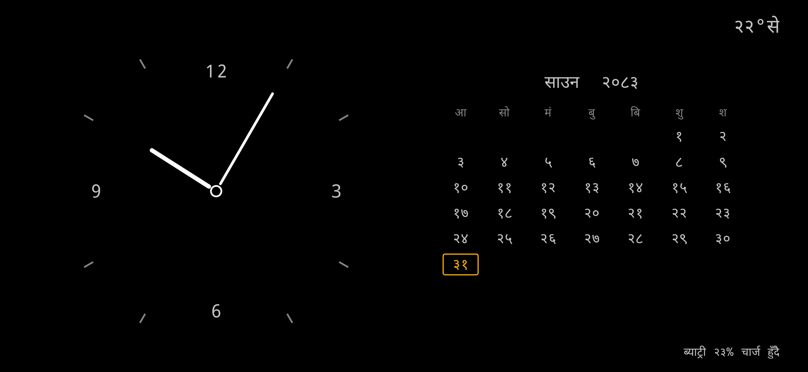

# NODE

**An old phone, rebuilt as a single-purpose desk clock.**

A Redmi Note 8 running stock MIUI — bootloader locked, no root, no custom recovery — turned
into a fixed-function appliance. NODE is an ordinary sideloaded app that behaves like hardware:
one screen, no notifications, no scrolling, nothing to tap through.



<p align="left">
  
  
  
  
  
</p>

---

## What it shows

| | |
|---|---|
| **Clock** | Analog dial, hairline ticks, numerals at 12/3/6/9, open ring pivot. **No seconds hand** — one redraw per minute |
| **Calendar** | Bikram Sambat month grid in Devanagari, Sunday-first, today in amber |
| **Temperature** | Local reading via [Open-Meteo](https://open-meteo.com), refreshed hourly. Dims when stale |
| **Power** | Battery percentage plus runtime remaining, from measured drain rather than the fuel gauge |

Every element reports real state. The first draft had decorative labels — `NODE_01`, `LOCAL`,
`SYSTEM // IDLE` — and they were removed once it became clear one of them displayed nothing at
all. If it is on screen, it means something.

## Design principles

**Nothing polls.** NODE owns no timers, no services, no background workers and no wake locks.
The display is driven entirely by the system's own minute pulse (`ACTION_TIME_TICK`), which is
delivered only to runtime-registered receivers — registered in `onStart`, dropped in `onStop`.
A backgrounded NODE costs nothing. Battery is read on demand from the sticky
`ACTION_BATTERY_CHANGED` broadcast rather than by holding a live receiver.

**Zero dependencies.** No AndroidX, no AppCompat, no Material. The `dependencies { }` block is
empty; `kotlin-stdlib` arrives via the Kotlin plugin. Weather uses `HttpURLConnection` and
`org.json`, both already in the platform. The custom views draw straight to `Canvas`.

**One permission.** `INTERNET`, for one HTTPS request per hour. There is deliberately **no
location permission** — station coordinates are a constant, because a desk appliance does not
move. No GPS wakeups, no drift.

**Honest about uncertainty.** A confident-looking number that is wrong is worse than no number.
The temperature dims when stale and shows `--°से` if it has never fetched. The runtime estimate
stays hidden until it has measured enough to mean something.

**The backlight is the entire power budget.** The panel is IPS, not OLED, so black pixels save
nothing — the black design is aesthetic. Only brightness and screen-off time matter.

## Requirements

- JDK 17 or newer
- Android SDK with platform 34 and build-tools 34.0.0
- A device on Android 11+ (API 30)

No Android Studio needed. No `cmdline-tools` needed if the platform and build-tools are already
present. The Gradle wrapper handles the rest.

## Build

```bash
git clone <this-repo>
cd node01-afterlife
./gradlew assembleDebug          # gradlew.bat on Windows CMD/PowerShell
```

Output lands at `app/build/outputs/apk/debug/app-debug.apk`. Point Gradle at your SDK by
creating `local.properties` (gitignored):

```properties
sdk.dir=/path/to/Android/Sdk
```

The first build downloads Gradle, AGP and Kotlin. Afterwards, `--offline` gives a clean build in
about 13 seconds.

## Install

```bash
adb devices -l
adb install -r app/build/outputs/apk/debug/app-debug.apk
```

> **On MIUI**, sideloading is refused with `INSTALL_FAILED_USER_RESTRICTED` until you turn
> **Developer options → Turn on MIUI optimization → OFF**. This is not an AOSP permission
> problem and needs no Mi account. See [engineering notes](docs/ENGINEERING-NOTES.md).

## Configure

Everything configurable is a constant — there is no settings screen, by design.

**Location** — `app/src/main/java/dev/node01/afterlife/Weather.kt`

```kotlin
object Station {
    const val LATITUDE  = 27.7017   // defaults to Kathmandu
    const val LONGITUDE = 85.3206
}
```

Open-Meteo's grid is about 10 km, so city-level coordinates are enough. While both values are
`0.0` the fetch is skipped entirely and the readout stays `--°से`.

**Quiet hours and timings** — `app/src/main/java/dev/node01/afterlife/NodeActivity.kt`

```kotlin
const val QUIET_START_HOUR = 23     // release the screen, let the device deep-sleep
const val QUIET_END_HOUR   = 7
const val UNDIM_MS         = 30_000L   // tap-to-undim duration
```

**Appearance** — `res/values/colors.xml` for the monochrome ramp and the amber accent,
`res/values/dimens.xml` for type sizes. The dial numerals are Latin by default; change
`NUMERALS` in `ClockView.kt` for Devanagari.

## Battery behaviour

The screen is held at the panel minimum during waking hours and released entirely during quiet
hours so Android can deep-sleep. **Tap anywhere to undim for 30 seconds** — NODE drops its
brightness override so the phone's own brightness applies, then restores the dim.

Measured on the test device: **~10 %/hour** with the screen lit, on a battery whose real
capacity is roughly half its original rating. Minimum brightness plus quiet hours roughly halves
daily consumption. Be realistic — an always-lit LCD cannot reach multi-day standby; only the
screen being off does that.

Quiet hours depend on the system screen timeout **not** being set to "Never".

## Project structure

```
app/src/main/java/dev/node01/afterlife/
├── NodeActivity.kt    window setup, receiver lifecycle, render pass,
│                      quiet hours, tap-to-undim, runtime estimate
├── ClockView.kt       analog dial drawn to Canvas
├── CalendarView.kt    Bikram Sambat month grid, Devanagari
├── BsDate.kt          BS↔AD conversion table and Devanagari digits
├── Weather.kt         station coordinates + Open-Meteo client
└── Mode.kt            DESK / TERMINAL / ARCHIVE / NIGHT / SLEEP
```

The app icon is a vector, so the repository carries no binary image assets other than the
Gradle wrapper and the screenshot.

## Roadmap

Only `DESK` is implemented. `Mode` already carries the per-mode brightness and screen-hold
behaviour, so the rest are additive:

- **TERMINAL** — restrained system-status readout
- **ARCHIVE** — 1970s–90s instrument panel aesthetic
- **NIGHT** — bedside, as dark as the panel allows
- **SLEEP** — display released entirely
- Mode switching, auto-off on idle, alarms

## Notes

Building against stock MIUI turned up a number of non-obvious platform behaviours — force-dark
silently inverting bright drawing, blocked sideloads, blocked synthetic input, window relayouts
surfacing the system bars, and a fuel gauge that cannot be trusted for runtime estimates. These
are documented in **[docs/ENGINEERING-NOTES.md](docs/ENGINEERING-NOTES.md)**.
