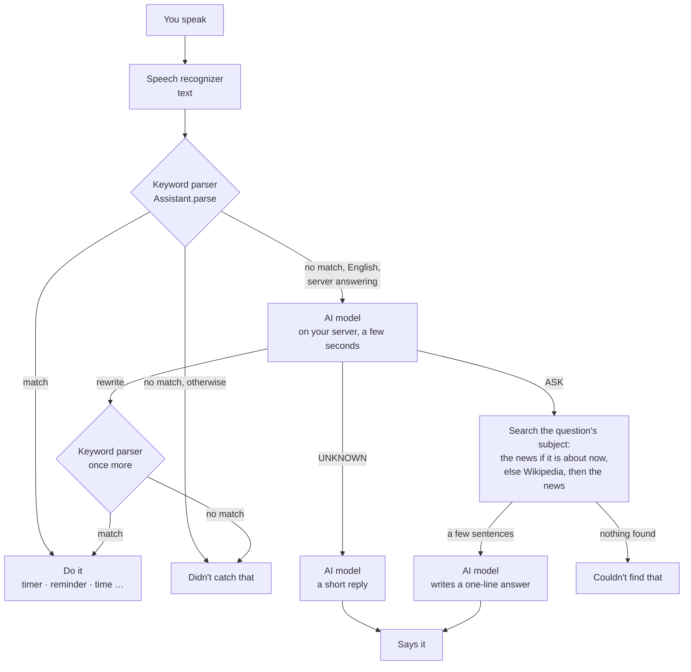

# NODE Companion

**An old phone, rebuilt as a face on your desk.**

A Redmi Note 8 running stock MIUI — bootloader locked, no root, no custom recovery — turned
into a small desk companion. Two dot-matrix eyes, cyan dots lit on a panel of faint ones like
an LED display, notice when you sit down, follow you, doze when you leave and sleep when the
lights go off. They wink, tilt, bounce, turn into hearts when you say thank you and go woozy
when you shake the phone. When Claude Code on your PC needs your
approval, they turn amber and chirp, so you can step away from the keyboard and still know.
Tap it or wave at it and it listens: ask the time, set a timer, have it remind you — in
English or Nepali, with no cloud AI. Run [a small AI model on your own server](#ai-on-your-own-server)
and it understands loosely worded English too, without anything you say leaving your LAN.

<p align="left">
  
  
  
  
  
</p>

It installs as **NODE Companion** (`dev.node01.companion`), and it is the NODE webcam too:
the page's **WEBCAM** buttons turn the phone into one or the other (see
[Webcam mode](#webcam-mode)). NODE began life as a desk clock; that version lives on at
`9a42e35`.

---

## What it does

| | |
|---|---|
| **Sees you** | The front camera's own face detection, done by the camera hardware. The eyes follow you, say hello with a double blink when you come back after a while, and look around the room when you have just left |
| **Sleeps** | Away 2 minutes: sleepy and dim. Away 10 minutes, or the room dark: eyes closed, backlight at the panel minimum |
| **Feels the desk** | Knock on the desk and it startles. Shake the phone and it goes woozy: its eyes loll round, one up as the other drops, until it shakes it off |
| **Briefs you in the morning** | The first time it sees you each morning, after "Good morning!": with [the AI model](#ai-on-your-own-server) answering, one friendly sentence made from the weather, what is due today and your open tasks; without it, or in Nepali, the time, the Bikram Sambat date, the weather, and how many things are waiting, each part dropped when there is nothing to say |
| **Notices what you do** | Only what you tick on the page: a drink (a cup or bottle raised to your face), a phone in your hand, a book. When one happens it reacts and chirps, and the page lists it: `10:42  a drink (3 today)`. It runs on the phone with MediaPipe's object detector, about one frame a second while you are there; see [Privacy](#privacy) |
| **Is pettable** | Rub a finger back and forth across the screen and its eyes turn to beating hearts: "Hehe." Petting never opens the microphone, so you can fuss over it without talking to it |
| **Swipes** | A straight swipe changes mode. **Sideways:** hand tracking on or off. **Up or down:** the corner readouts — usage, the time, the PC's load — hidden for a bare face, or shown again; a running timer always shows. Swipes that start at a screen edge are left to the system |
| **Sees your hands** | With hand tracking on, whenever the front camera sees a hand, it takes the eyes' place in white dots: every bone as a line of dots, every fingertip a small cross, up to two hands, mirrored like a mirror. With no hand in view the face carries on, and after a minute without one the mode turns itself off. It runs on the phone with Google's MediaPipe; see [Design principles](#design-principles) |
| **Plays** | Say hi and it winks; say "thank you" and its eyes turn to beating hearts. While you sit there it now and then winks, tilts its head or squints; with nobody there it looks around the room; asleep, Z's float up. Listening, it tilts its head. Every animation and expression can also be played from the page |
| **Listens** | Tap the screen or wave over its top edge, wait for the blip, and speak — English or Nepali. Nothing listens until you do. See [Voice](#voice) |
| **Talks** | A few short words of its own: "Welcome back!" ("Good morning!" once a morning), "Hey! Claude needs you.", "All done!", "Whoa!" at a knock, "Good night." when the lights go off. At most one unprompted line every 20 seconds, and in a dark room only Claude needing you or finishing; `TALK` in `NodeActivity.kt` turns it off |
| **Claude Code** | Through Claude Code hooks on your PC. While Claude works the eyes narrow and look toward the PC, and now and then read along a line or two, look up to think, or narrow harder for a moment, so the stare never sets. When Claude needs approval or has a question: amber, wide, an amber **!!** beside them, `NEEDS YOU`, one chirp, and it says what Claude is asking to do — "Claude wants to delete the build folder." — from Claude's own description of the command, a file's name or a site. When it finishes: a happy bounce, then **^ ^** eyes, `DONE`, a softer chirp — held until you have actually looked |
| **Desk notes** | Send a short note from any browser, now or in a few minutes — or say "remind me in 10 minutes to stretch". It shows in amber and is read out; tap or wave to dismiss it |
| **Keeps your tasks** | Add a task with a few lines of detail from the page. NODE chirps once and keeps it out of sight — no amber, no words. Hold a finger on the screen to see the list; tap a task for its details and **✓ MARK DONE**. Up to 30 at a time, kept across restarts |
| **Looks after your aquarium** | Tell it when you feed the fish or change the water and it keeps the schedule, reminds you of what is overdue, and warns about feeding twice. While the tank's light is on the rear camera watches it, beside the face's camera, and keeps pictures and video for training; once a day the AI on your server describes the picture. See [Aquarium](#aquarium) |
| **Shows its view** | The page's **CAMERA** section shows what the front camera sees, small and live (320×240), only while you have it showing in a tab that is in view. Nothing is recorded. See [Privacy](#privacy) |
| **Shows the PC's load** | Leave the page's PowerShell lines running and the PC's CPU, memory and disk activity sit small and dim in the bottom-left corner — a chip, a memory stick and a disk, each with its number. Stop the script and they are gone within 15 seconds |
| **Tells the time** | The time, 12-hour (`12:48`), in small grey dots in the top-right corner. A running timer takes its place, and in the dark it steps aside for the large knock clock |
| **Counts a timer down** | While a timer or focus session runs, the time left ticks in grey dot digits in the top-right corner — `24:59`, and whole minutes past an hour. Glance and see how long is left without asking |
| **Tells the time in the dark** | Knock the desk in a dark room and the time appears in dots where the eyes are, for six seconds, with the backlight barely lifted and not a sound |
| **Watches its own battery** | A phone that lives on a charger swells quietly. At **45°C** it goes amber with `BATTERY HOT · 47°C` until it is properly cool again (under 42°C, so it cannot flicker), and unplugged at **20%** it says `UNPLUGGED · 18%`. One chirp as either starts, not one per degree |
| **Says what you send** | `POST /say` with `text=…`, from the page or one line of curl in a script, and NODE reads it out once: "Build done." Grey under the eyes, nothing to dismiss, quiet in a dark room. Nepali text is spoken in Nepali |
| **Session %** | How much of your 5-hour Claude session limit is used, as `/usage` shows it: just the number, such as `42%`, in small grey dot digits in the top-left corner. It comes from Claude Code's status line, which gets it only on Pro and Max plans and only runs in the terminal version (not the VS Code panel); the page has the lines to add to your status line script. They send the percentage and when the window resets, nothing else. After the reset it shows `0%`. At **80%** and **95%** it says so once, and you can ask "how much of my session is left?" |

Amber means one thing: something needs you. Everything else is cyan dots on black.

## Use it

1. Build and install (below), open **NODE Companion**, allow the camera and the microphone.
2. **Hold a finger on the screen** for a moment to see your tasks and, under them, its address
   for 30 seconds, such as `http://192.168.1.50:8081/k7m2x9qa4c/`. Tap beside the list to close it.
3. Open that address on any phone or PC on the same Wi-Fi. The page sends desk notes and tasks,
   shows the camera's view when you ask it to, has NODE say a line out loud, plays the face's
   animations, has a **Try it** row to test the
   Claude states, and shows the Claude Code hooks, the status line lines for the session % and
   the PowerShell lines for the PC's load, with the address already filled in.

The screen stays on because Android only lets the app in front use the camera. Leaving NODE,
or pressing the power button, stops everything; coming back resumes it.

## Claude Code

Add these hooks to `~/.claude/settings.json` on the PC, merged into any `hooks` you already
have. The phone's own page shows this block with your address filled in, and copies it.

```json
{
  "hooks": {
    "UserPromptSubmit":  [{ "hooks": [{ "type": "command", "async": true, "command": "curl.exe -s -m 2 -H Content-Type:application/json --data-binary '@-' http://192.168.1.50:8081/k7m2x9qa4c/claude" }] }],
    "PermissionRequest": [{ "hooks": [{ "type": "command", "async": true, "command": "curl.exe -s -m 2 -H Content-Type:application/json --data-binary '@-' http://192.168.1.50:8081/k7m2x9qa4c/claude" }] }],
    "Notification":      [{ "hooks": [{ "type": "command", "async": true, "command": "curl.exe -s -m 2 -H Content-Type:application/json --data-binary '@-' http://192.168.1.50:8081/k7m2x9qa4c/claude" }] }],
    "PostToolUse":       [{ "hooks": [{ "type": "command", "async": true, "command": "curl.exe -s -m 2 -H Content-Type:application/json --data-binary '@-' http://192.168.1.50:8081/k7m2x9qa4c/claude" }] }],
    "PostToolUseFailure":[{ "hooks": [{ "type": "command", "async": true, "command": "curl.exe -s -m 2 -H Content-Type:application/json --data-binary '@-' http://192.168.1.50:8081/k7m2x9qa4c/claude" }] }],
    "Stop":              [{ "hooks": [{ "type": "command", "async": true, "command": "curl.exe -s -m 2 -H Content-Type:application/json --data-binary '@-' http://192.168.1.50:8081/k7m2x9qa4c/claude" }] }],
    "SessionEnd":        [{ "hooks": [{ "type": "command", "async": true, "command": "curl.exe -s -m 2 -H Content-Type:application/json --data-binary '@-' http://192.168.1.50:8081/k7m2x9qa4c/claude" }] }]
  }
}
```

- Every hook runs **in the background** and curl gives up after 2 seconds, so a phone that is
  asleep, away or switched off never slows Claude down.
- `PermissionRequest` and the `permission_prompt`, `elicitation_dialog` and
  `agent_needs_input` notifications mean **needs you**. The next `PostToolUse` — Claude
  carrying on after you approve — clears it. `Stop` means **done**. `SessionEnd` forgets the
  session.
- `PostToolUseFailure` — a command that exited non-zero, an edit that would not apply —
  gets a **sad face for a moment**, and nothing else: no chirp, no words, and at most one
  every 30 seconds. Failures are ordinary work. Stopping a tool yourself (`is_interrupt`)
  is not one.
- Working for more than 20 minutes without a pause shows `STILL WORKING · 23m` in grey, so a
  long job is visibly alive rather than possibly stalled. An approval in the middle starts the
  count again.
- Several sessions at once: the most urgent wins and the caption counts the rest (`+1`).
- Hooks are best-effort, so nothing is claimed forever: "working" with no event for 20
  minutes is dropped rather than shown as still busy.
- Give the phone a **DHCP reservation** in your router, or its address — and these hooks —
  will drift. Run `/hooks` in Claude Code to check they loaded.

## Voice

**Tap the screen or wave over its top edge**, wait for the blip, and say one sentence. What it
hears appears under the eyes as you speak; the answer is shown and spoken. Tap again to stop
listening. There is no wake word and nothing listens in the background. (A hands-free mode,
with or without "Hey Buddy", is still in the code, switched off: `WAKE` in `NodeActivity.kt`.)

| Say | Or in Nepali | NODE |
|---|---|---|
| "What time is it?" | "कति बज्यो?" | Tells you |
| "What's the date?" | "आज कति गते?" | Gregorian and Bikram Sambat |
| "Set a timer for 5 minutes" | "पाँच मिनेटको टाइमर" | Rings and says so when it runs out |
| "Focus" / "Focus for 50 minutes" | "फोकस" | 25 minutes unless you say otherwise, then tells you to take a break |
| "Cancel the timer" | "टाइमर रद्द गर" | Calls off timers and repeating nudges alike |
| "Remind me to stretch every 45 minutes" | "हरेक ४५ मिनेटमा पानी पिउन सम्झाउनु" | Only while the camera can see you are there: a nudge you walked away from comes round again instead of piling up |
| "Remind me in 10 minutes to stretch" | "दस मिनेटपछि पानी पिउन सम्झाउनु" | Shows and reads it out then |
| "Remind me at 5:30 to call mom" | "५ बजे पानी पिउन सम्झाउनु" | At that time today, or tomorrow if it has passed. Without "am" or "pm" it takes whichever comes first |
| "Wake me at 7 am" / "Set an alarm for 6:30" | "७ बजे उठाउ" | Chirps every 10 seconds until you tap it, dark room or not. Say "am" or "pm", or it takes the next time the clock reads that |
| "Take a note: buy milk" | "नोट दूध किन्नु" | A desk note, shown now |
| "What's 17 times 23?" / "15% of 2400" | "१० जोड ५" | Two numbers and one operator — plus, minus, times, divided by, percent of |
| "10 km in miles" / "70 kilos in pounds" | "२० डिग्री फरेनहाइटमा" | km↔miles, kg↔pounds, °C↔°F, and Nepali↔Indian rupees at the fixed 1.6 peg. Whole numbers |
| "What is Claude doing?" | "Claude के गर्दैछ?" | Working, needs you, or done — and where |
| "How much of my session is left?" | "सेसन कति बाँकी छ?" | The 5-hour window: the percentage used, and when it resets |
| "Go to sleep" / "Wake up" | "सुत" / "उठ" | Eyes closed and dim until a tap; alerts still wake it |
| "Speak Nepali" / "English" | "नेपालीमा बोल" / "अंग्रेजीमा बोल" | Which language it listens for first |
| "Say anything you like" | "नमस्ते भन" | Repeats it back — and a quick way to hear whether a voice is installed |
| "Spell Kathmandu" | "हिज्जे काठमाडौं" | One letter at a time |
| "Flip a coin" / "Roll a dice" / "Pick a number between 1 and 10" | "सिक्का उफार" / "पासा" | Settles an argument |
| "Start a stopwatch" / "How long?" | "स्टपवाच" / "कति समय भयो" | Counts up, and keeps counting through a screen off |
| "Louder" / "Quieter" | "ठूलो स्वर" / "बिस्तारै" | One step of the phone's media volume |
| "I fed the fish" / "Water change done" / "Cleaned the filter" | "माछालाई खाना दिएँ" / "पानी फेरें" | Logged for the [aquarium](#aquarium); a second feeding within 4 hours gets a word about overfeeding |
| "When did I last change the water?" / "How is the tank?" | "माछा कस्तो छ?" | When it was done; how the tank is doing, answered by the AI on your server from all it knows |
| "Be quiet" / "You can talk" | "चुप" | Quiet mode: no chirps or spoken lines for Claude or small talk, amber still shows. Alarms still ring. Until you say "you can talk", or the app restarts |
| "Sing" | "गीत गाऊ" | Seven notes and a bounce, which is as much singing as a dot-matrix face can manage |
| "What's the news?" / "News about cricket" | "समाचार" | The top three headlines from Google News, in English |
| "Will it rain tomorrow?" / "What's the weather?" | "भोलि मौसम कस्तो छ?" | Now and the rest of today, or tomorrow: the sky, low and high, and the chance of rain |
| "Set a timer for 10 minutes and remind me at 5 to call mum" | | Both, answered together. Only where each half is a request on its own, so "remind me to call dad and wish him good night" stays one reminder |
| "Help" | "मद्दत" | Lists these |
| "Hi" / "Hello" | "नमस्ते" | Says hi back, with a wink |
| "Good morning" / "Good afternoon" / "Good evening" | "शुभ प्रभात" / "शुभ दिन" / "शुभ साँझ" | Says it back: "Good morning!" |
| "Nice to meet you" / "Good to see you" | "भेटेर खुसी लाग्यो" | "Nice to see you too!" |
| "I'm back" | "म आएँ" | "Welcome back!" |
| "How are you?" / "What's up?" | "कस्तो छ?" | "I'm good, thanks! How are you?" — and "I'm fine" gets "Glad to hear it!" |
| "What's your name?" | "तिम्रो नाम के हो?" | "I'm NODE, your desk buddy." |
| "Bye" / "See you" | "बाइ" | "Bye! See you soon." |

It answers in the language you spoke. These are matched by keyword, which is instant. An
English sentence the keywords miss goes to [the AI model on your server](#ai-on-your-own-server),
while it answers. The model rewrites it into one of the phrases above, so "ping me in ten to
stretch" works like "remind me in 10 minutes to stretch", [answers a question about the
world](#questions) from Wikipedia or the news, and has a word back for anything else you say to
it: "I'm so bored" gets a short, friendly reply. A follow-up within two minutes carries on the
conversation: "who wrote Harry Potter?", then "when was she born?". Meanwhile the eyes' dots stream off in a swarm and
rebuild themselves as a small cat, which plays until the answer is ready -- walking to and fro,
turning at the edges, sitting or lying down a while with its tail flicking, stretching out flat,
hopping, crouching and pouncing -- and then streams back into eyes: about 2 seconds for a command
and 4 for a reply on the server's CPU, more for a question, which is searched first. Every unmatched Nepali sentence gets "Sorry, I
didn't catch that".

**Offline first, online if need be.** NODE asks the phone's speech recognizer to work offline,
which needs the Google app's offline model for the language (Google app → profile picture →
Settings → Voice → Offline speech recognition; the recognizer then fetches its own copy in the
background, on Wi-Fi and charging while the phone is idle). Until that model is there, NODE
uses Google's online recognition instead: the sentence goes to Google to be turned into text,
and the caption says `· online` while it listens. It tries offline again every ten minutes.
Spoken answers use a voice installed on the phone where there is one; Nepali, with none here,
uses Google's online voice. See [engineering notes](docs/ENGINEERING-NOTES.md).

## AI on your own server

NODE can use a small, ready-made AI model that runs on your own computer on the LAN, under
[Ollama](https://ollama.com): never a cloud AI. Nothing is trained: the model
is told NODE's commands and shown a few examples, and rewrites a loosely worded English
sentence into a phrase NODE already understands. The keyword parser still decides what that
phrase means, so the model can never do anything a spoken sentence couldn't already do. While
the server is off or unreachable, NODE goes by keywords only, as before, and tries the server
again every minute.

| You say | The model rewrites it as | NODE |
|---|---|---|
| "ping me in ten to stretch" | `remind me in 10 minutes to stretch` | Sets the reminder |
| "nudge me after lunch to call mum" | `remind me at 1 pm to call mum` | Sets it for 1 pm |
| "how late is it" | `what time is it` | Tells you |
| "who wrote harry potter" | `ASK` | Looks it up: "J. K. Rowling wrote Harry Potter." |
| "what tournament is on right now" | `ASK` | Looks it up in the news |
| "i'm so bored" | `UNKNOWN` | Talks back, in one short sentence |



What the model is told is `COMMANDS` and `EXAMPLES` in `Rephraser.kt`. Each sentence is sent
with them, on its own, so nothing said carries over to the next one; Ollama keeps them read
from the sentence before, so only the new words cost time. Answers and replies have a conversation of their own, carried on
for two minutes after NODE last spoke (`TALK_MS`), so a follow-up knows what came before. `RephraserTest` checks that the model is only ever shown
phrases NODE understands. When it gets a sentence wrong, add it to `EXAMPLES` with the phrase
it should have been. That exact sentence, capitals and punctuation aside, is then answered
straight from `EXAMPLES` without asking the model, which does not always copy what it is shown;
sentences worded like it are left to the model, which the example helps along.

### Set up the server

Any computer on the LAN that runs [Ollama](https://ollama.com) will do; here it is an old
laptop (Core i7-5500U, 8 GB, no usable GPU, Debian). Pull the model and let Ollama listen on
the LAN, not only on the laptop itself:

```bash
ollama pull qwen2.5:3b
sudo mkdir -p /etc/systemd/system/ollama.service.d
printf '[Service]\nEnvironment=OLLAMA_HOST=0.0.0.0:11434\n' | sudo tee /etc/systemd/system/ollama.service.d/lan.conf
sudo systemctl daemon-reload && sudo systemctl restart ollama
```

Ollama has no password: anyone on your Wi-Fi can use the model. NODE asks for it to stay
loaded (`keep_alive`), since loading it again costs the next sentence half a minute. The
server's address is `SERVER` in `Rephraser.kt` and, because Android refuses plain HTTP
elsewhere, `res/xml/network_security_config.xml`: change both together, and give the server a
fixed address in your router. The model is `MODEL`. Tried on that laptop, with NODE's
instructions and 22 sentences the keywords miss (loosely worded commands, questions and noise):

| Model | Right | Each sentence | Verdict |
|---|---|---|---|
| `qwen2.5:3b` | 18 of 22 | 1–2.6 s | Use this |
| `gemma3:4b` | 17 of 22 | about 31 s | Reads all of NODE's instructions again for every sentence, where Qwen reads only the new words |
| `qwen2.5:1.5b` | 13 of 22 | about 1 s | Too often wrong: questions came back as commands |

Earlier, run on the phone itself with LiteRT-LM, Qwen2.5 1.5B took 2–9 s a sentence and 2.7 GB
of the phone's memory. Mistakes are real commands -- qwen2.5:3b made "quarter to seven" 6:30 --
so it is worth listening to what NODE says back. A hot laptop slows down: with its CPU at
100 °C, gemma3:4b took half as long again.

`adb logcat -s NODE` shows how the server rewrote a test sentence when it first answers,
`model: warm-up "is it getting late" -> "what time is it"`, `model: server not answering`
when it goes away, and how long each sentence took. What the model was asked and what it made
of it goes to `asked.log` on the phone, one dated line each, and each new line drops those
older than a week:

```bash
adb shell cat /sdcard/Android/data/dev.node01.companion/files/asked.log
# 2026-11-22 01:35:40  "what is the capital of nepal" -> ASK -> "Kathmandu" (17.5 s)
```

### Questions

A question about the world ("who wrote harry potter", "how tall is mount everest") gets `ASK`
from the model, and then:

1. **Search.** NODE searches Wikipedia for the question's subject, with the question words
   taken out ("harry potter"). A question about now ("today", "latest", "right now", "score")
   searches Google News instead, and so does one Wikipedia has nothing for. That search, under
   a generic client name, is the only thing that leaves your LAN. No key or account, and no AI
   company sees it. A follow-up that leans on the last question ("how old is he?") is first said
   again in full by the model ("when was J. K. Rowling born"), so the search has a subject. A sentence
   worded as a question about the world ("who…", "where…", "how far…", but not about you or NODE)
   is looked up even when the model takes it for small talk.
2. **Notes.** From the top two articles' opening paragraphs it keeps two sentences: the first
   one, which says what the subject is, and the one that shares most words with the question
   (rarer words count for more, and "tall" counts as "height"). From the news, the top five
   headlines. The model reads about 15 words
   a second on the server, so fewer words mean a sooner answer.
3. **Answer.** The same model on your server writes one short sentence from those notes, and NODE
   says it, with a little nod. If the notes don't answer it: "Sorry, I couldn't find that."

The model's part takes about 4 seconds on the server; the search adds its own. It knows only what
Wikipedia's opening paragraphs and the day's headlines say, and an answer can be wrong. Ask the
weather by keyword instead ("will it rain tomorrow?"): that goes to the forecast. `Lookup.kt`
does the searches and picks the notes.

## Aquarium

Put the phone on the desk between you and the tank, its screen to you and its rear camera
to the glass. The face carries on as before; the aquarium is extra. Fill in the page's
**AQUARIUM** section (litres, the fish, how often each job comes round), or just tell NODE the
first time you feed them: either sets the tank up.

**Jobs.** Five, with defaults for a low-tech planted tank: feeding (every day), a water change
and fertiliser (every week), a plant trim (every two weeks) and cleaning the filter (every
month). Say one is done — "I fed the fish", "water change done", "cleaned the filter",
"trimmed the plants", "added fertiliser" — or press **Done** on the page. An overdue job shows
in amber and is read out, once a day, while you are at the desk; saying it is done clears it,
and "dismiss" puts it off until tomorrow. "When did I last change the water?" and "did I feed
the fish?" are answered from the log, which stays on the phone for a week (`tank.log`).

**Watching while the light is on.** This phone runs its front and rear cameras at once, so the
face keeps following you while the rear camera watches the tank. Every 10 minutes a quick look
(a few seconds) checks whether the tank's light is on; if it is, the rear camera stays on it
(`TankWatch`) until the light has been off three minutes. While it watches:

- every minute, a picture and its numbers: whether the light is on, how green the picture is,
  and how much moved, from small grey frames five times a second;
- every 10 minutes, those numbers are set against the last week's: water turning greener raises
  the guessed risk below, and two in a row with the fish far stiller than usual leave a note,
  "The fish look unusually still. Check on them?" (`tank-stats.log`; the thresholds in
  `TankLook.kt` are reasoned, not yet tuned on a real tank);
- 720p video with no sound, in five-minute clips, about the last three days
  (`files/tank-video/`);
- **Live view** on the page shows it, upright, while the tab is in view.

**A description once a day.** The first lit look of the day goes to `gemma3:4b`, the model on
your server that can see, which says in a sentence or two what the picture shows: the water,
the plants, any fish. It takes about 100 seconds on that laptop; **Describe it now** on the page
asks again. On a real picture it found the plants and two fish, called the water relatively
clear, and invented a yellow fish while missing one on the sand. It is only a description, shown on the page and handed to "how is the tank?", and
never sounds an alert: asked whether anything looked wrong, gemma3:4b found cloudy green water
in a photo of a cardboard label.

**The water, guessed.** With no test kit, NODE cannot know ammonia, nitrite or nitrate, and
never claims a number. It guesses from care habits: days since the last water change against
its interval, feeds a day over the last three days (more than two counts), and the camera's
word that the water is greening. One reason makes the risk *building*, two or a water change
twice overdue make it *high*. "How is the tank?" gets all of this from the AI on your server,
in a sentence or two; with the server away, a fixed line: what is overdue, and the guess.

### Training data

For a model of your own later, NODE keeps, under `Android/data/dev.node01.companion/files/training/`:
a folder a day of the minute pictures while the tank is lit (`HHmmss.jpg`, about 200 KB each,
kept 60 days), a `minutes.csv` beside them with each picture's light, green and movement, and
`labels.jsonl`, one line per description of a picture: the AI's (`"from":"ai"`) and yours
(`"from":"you"`). Yours come from the page's **TRAINING** section: write what is really in the
newest picture, or what is wrong with it — "no yellow fish; a loach on the sand" — and it is kept
beside that picture. The latest is also handed to "how is the tank?", to be believed over the AI.
With the video, that is roughly 10 GB a day of a tank lit twelve hours; the phone keeps at least
2 GB free whatever happens. Copy it off with `adb pull`.

### Later: real sensors

The camera cannot feel temperature, and a failed heater is the quickest way to lose fish. An
ESP32 board (about $5), a waterproof DS18B20 temperature probe (about $3) and a 4.7 kΩ resistor
would read the water's temperature every minute and send it to NODE over Wi-Fi, the way the
[PC load](#use-it) script does, for an alert the moment it drifts. A TDS probe could follow
how much is dissolved in the water between changes, and a smart plug could switch the light.
None of this is built yet.

## Webcam mode

The phone is the companion or a webcam, never both at once. On the page, **WEBCAM → Webcam**
stops the face, the front camera and the voice assistant, and starts the rear camera:

- `http://<phone>:8081/<key>/webcam` is the live view, with sound and a list of recordings.
  `…/video` is the bare MJPEG stream, for OBS Studio's Browser or Media source.
- 1080p clips of five minutes each are recorded to the phone, oldest deleted first when space
  runs short, and downloadable from `…/rec/`.
- The screen shows one dim dot. A tap shows the address; **holding a finger on the screen
  brings the face back**, as does **WEBCAM → Face** on the page.
- Notes, tasks and Claude Code events sent meanwhile are kept, silently, and shown when the
  face returns.
- The mode is remembered, so after a power cut the phone comes back as whichever it was.

## Privacy

- **In webcam mode the rear camera and the microphone are on, streamed and recorded.** Only in
  that mode, only while NODE is in front, and only to the phone and to whoever opens the
  webcam page with the key. The clips stay on the phone until they are overwritten.
- **With an aquarium set up, the rear camera watches it the whole time its light is on**, in
  the face's mode too, and records it: a picture a minute (kept 60 days), video with no sound
  (about three days), on the phone. The page shows the newest picture, and the live view, to
  whoever opens it with the key, as plain HTTP across your Wi-Fi. Once a day one picture goes
  to the AI on your own server to be described, and nowhere else. The microphone is not used.
  Point the rear camera at the tank, not at the room: whatever it sees is recorded.
- **Camera activities are off until you tick them on the page.** Then about one frame a second
  goes to MediaPipe's object detector on the phone, while you are at the desk; only the names
  of what it found (cup, bottle, phone, book) and where, high or low, come out of it. No frame
  is kept or sent. What it noticed goes to `activity.log` on the phone, kept for a week, and to
  the page.
- **Hand tracking reads the camera on the phone and nowhere else.** While the mode is on, frames
  go to the MediaPipe model on the phone; only the points of each hand come out of it, drawn on
  the screen and then forgotten.
- **The camera leaves the phone only when you open the page's camera view.** For following
  you, frames are handed back to the camera unread, and only the rectangle of the largest
  face is used, as a gaze direction. While someone has the page's **CAMERA** view open,
  showing, in a tab that is in view, the front camera's picture goes to that browser: 320×240,
  about 7–10 frames a second, live only. Hiding it, switching tabs or closing the page stops it,
  and the phone goes back to not reading frames at all. Nothing is ever recorded, stored or
  logged, on the phone or anywhere else.
- **The phone does not show when someone is watching.** Anyone on your Wi-Fi with the address
  can open the camera view, and the face looks the same whether or not they do. The view
  crosses your Wi-Fi as **plain HTTP**, so anyone able to read your Wi-Fi traffic could see
  it too. The key in the address is all that guards it.
- **The microphone is open only when you ask.** After a tap or a wave, for one sentence. There
  is no wake word and nothing listens in the background. Recognition is offline when the
  phone has the model and online through Google when it does not, and the screen says
  which; see [Voice](#voice).
- **No cloud AI.** The voice assistant is a fixed set of commands. With
  [an AI model on your own server](#ai-on-your-own-server), an English sentence the keywords
  miss goes to that server over your Wi-Fi as **plain HTTP**, with the notes for an answer and
  the last two minutes' conversation; the model writes every answer there. What it was asked
  and answered is logged on the phone, in `asked.log`, for a week.
  Four things leave your LAN and nothing else does: online speech when the offline
  model is missing; a [question](#questions) the model sorts as one for the web, whose subject
  goes to Wikipedia's or Google News's search under a generic client name; asking for the news,
  which fetches Google News's headlines (with a topic, if you name one); and the weather — a
  fixed pair of coordinates (`LAT`/`LON` in `Weather.kt`, yours to change) sent to Open-Meteo,
  with no key, no account and nothing about you or the phone.
- A hook event contains your prompt and the tools' input and output. NODE keeps only the event
  name, session id, project folder and notification type, and for a permission request the
  tool's name and the few fields of its input it says aloud (a command's description, a file
  name, a site, a search). It reads past the rest without keeping it, and never logs it — but the whole event still crosses your Wi-Fi as **plain HTTP**.
  Use it on a network you trust.
- Tasks, desk notes and the PC's load cross the Wi-Fi as plain HTTP too. The PC's load is three
  numbers and nothing else; tasks are kept on the phone until you mark them done.
- The random key in the address is the only thing between the network and NODE. Anything
  without it gets a 404. Never port-forward 8081.

## Leaving it running

- **Set NODE Companion as the default Home app and the screen lock to None.** After a reboot
  or a crash it then comes straight back without anyone touching it.
- **Or make the phone nothing but NODE** (kiosk). This needs a phone with no accounts on it and
  working `adb shell` — a clean custom ROM, not stock MIUI, where it sits behind a Mi account.
  In this order, because afterwards no system dialog can appear:
  1. Install, open NODE and allow the camera and the microphone.
  2. Tick "Always allow from this computer" on the USB debugging prompt, then
     `adb shell settings put global adb_allowed_connection_time 0` so that never expires.
  3. `adb shell dpm set-device-owner dev.node01.companion/dev.node01.afterlife.NodeAdmin`,
     then reboot.

  From then on there is no lock screen, no launcher, no bars, no Home or Recents: the phone
  boots into NODE and stays there. Updating with `adb install -r -t` still works. To get
  Android back, any one of: `adb shell dpm remove-active-admin
  dev.node01.companion/dev.node01.afterlife.NodeAdmin`;
  `curl -d to=release http://<phone>:8081/<key>/mode`; or a wipe from recovery.
- **Keep it on the charger, with airflow,** and check the battery for swelling now and then.
  The front camera runs at its smallest size and 15 fps, far lighter than the webcam's 1080p
  recording, but an old battery held at 100% around the clock is still the real hazard.

## Design principles

**Nothing runs in the background.** The camera, sensors, server, Wi-Fi lock and the face's own
timers start in `onStart` and stop in `onStop`. A backgrounded NODE costs nothing.

**Answer at once.** Left alone, the phone's Wi-Fi dozes between packets and the first request
after a quiet spell took up to three seconds to connect — longer than a hook waits. NODE holds
a low-latency Wi-Fi lock, which Android honours only while the app is in front with the screen
on.

**A still face costs nothing.** The eyes redraw only while they move. A frame decides which
of the panel's ~3,000 dots light, draws those in one call over the unlit grid (drawn once per
screen size), and softens the same on/off map, a pixel per dot, into the glow. Animations are a
function of their own progress, and blinks, glances and fidgets are single delayed callbacks,
not a frame loop.

**One runtime dependency.** Camera2's hardware face detection, `SensorManager`,
`SpeechRecognizer`, `TextToSpeech`, `AudioTrack` and `java.net` are all in the platform. The
chirps are synthesized at start-up, so the repo carries no sound files. The exception is hand
tracking: Google's MediaPipe hand landmarker (`tasks-vision`) and its 7.8 MB model, which run
on the phone, are loaded only while the mode is on, and take the APK from about 3 MB to 25 MB.
[The AI model](#ai-on-your-own-server) runs on your server and is reached with `java.net`, so it
needs no library. JUnit is test-only and never reaches the APK.

**One pure function decides.** `Mood.decide` turns what NODE senses into what it shows, and is
unit-tested like any other function. The activity only gathers inputs and draws the answer.

**Honest status.** Amber only when something really needs you. If the camera cannot see, the
screen says why.

## Requirements

- JDK 17 or newer
- Android SDK with platform 34 and build-tools 34.0.0
- A device on Android 11+ (API 30) with a front camera that has hardware face detection.
  Check with `adb shell dumpsys media.camera` — the front camera's
  `android.statistics.info.availableFaceDetectModes` must include `1` or `2`

## Build

```bash
git clone <this-repo>
cd node01-afterlife
git switch feature/companion
./gradlew testDebugUnitTest assembleDebug     # gradlew.bat on Windows CMD/PowerShell
```

Output lands at `app/build/outputs/apk/debug/app-debug.apk`. Point Gradle at your SDK by
creating `local.properties` (gitignored):

```properties
sdk.dir=/path/to/Android/Sdk
```

## Install

```bash
adb devices -l
adb install -r -t app/build/outputs/apk/debug/app-debug.apk
```

`-t` is required: the app is marked test-only, which is what keeps an `adb` way out of the
kiosk (see [Leaving it running](#leaving-it-running)).

Then open NODE Companion and tap **Allow** for the camera. On MIUI, `adb shell pm grant` is
refused without a Mi account, so the tap is needed.

> **On MIUI**, sideloading is refused with `INSTALL_FAILED_USER_RESTRICTED` until you turn
> **Developer options → Turn on MIUI optimization → OFF**. See
> [engineering notes](docs/ENGINEERING-NOTES.md).

## Configure

Everything configurable is a constant — there is no settings screen, by design.

| What | Where |
|---|---|
| Which side the PC is on, timings for sleepy / asleep / greeting / startle | `Mood.kt` |
| Dot grid and dot size, eye size, spacing and glow, how far they move, blink, glance and fidget timing, how each animation moves | `FaceView.kt` |
| Expression shapes, and the list of animations | `Eyes.kt` |
| Gaze direction flips for another phone or mount | `Presence.kt` (`GAZE_FLIP_X/Y`) |
| Knock and shake sensitivity, wave timing, how dark is dark | `Senses.kt` |
| Chirp pitches and loudness, and the tune it sings | `Chirp.kt` |
| Where the weather comes from | `Weather.kt` (`LAT`/`LON`) |
| The aquarium's jobs and their defaults, how often it looks, what counts as greener or still, how long training data and video are kept | `Tank.kt`, `NodeActivity.kt` (`TANK_EVERY_MS`, `TRAINING_DAYS`), `TankLook.kt`, `TankWatch.kt` |
| The AI model's server and model, and what it is told | `Rephraser.kt` (`SERVER`, `MODEL`, `EXAMPLES`), with the address in `res/xml/network_security_config.xml` too |
| When the battery counts as hot or low | `Battery.kt` |
| Voice commands, their wording and replies | `Assistant.kt` |
| What it says unprompted, and how often | `Chatter.kt` |
| Voice pitch and speed | `Speaker.kt` |
| How long "working" and "done" last | `ClaudeSessions.kt` |
| Port, body limits | `HttpServer.kt` |
| Brightness levels, tap-to-undim time | `NodeActivity.kt` |
| Colours and type sizes | `res/values/colors.xml`, `res/values/dimens.xml` |

## Limits

- It cannot see in a dark room, so in the dark it sleeps rather than pretending to follow you.
- Everything stops whenever NODE is not in front — the power button included.
- Only one Claude Code PC is expected; sessions from several PCs work, but share one face.
- A clock-time reminder reaches today or tomorrow, whichever comes first — there is no "on
  Friday" and no "tomorrow at nine". A desk note from the page is still due now or within 24 hours.
- No wake word: you tap or wave to talk to it, by design.
- Voice understands a fixed set of phrasings and greetings, not free conversation.
- No converting one calendar to the other by voice. Spoken into the English recognizer, a
  Nepali month name comes back as whatever English word sounds nearest — "Mangsir" arrives
  as "monkey" — and accepting those guesses was worse than not offering it. "What's the
  date?" still answers in both calendars, which is what the converter was mostly used for.
- Sums are two numbers and one operator; conversions are whole numbers. Neither takes a chain.
- A repeating nudge only fires while the camera can see you, so it is no use for anything
  that must happen whether you are at the desk or not.

## Project structure

```
app/src/main/java/dev/node01/afterlife/
├── NodeActivity.kt    window, permissions, start/stop, gathers inputs, applies the look
├── Mood.kt            the personality: inputs → expression, gaze, caption, brightness
├── FaceView.kt        the dot-matrix panel: draws and animates the eyes
├── Eyes.kt            expression shapes, easing, the animations
├── Presence.kt        front camera face detection → gaze, and the page's camera view while it is open
├── Hub.kt             hands camera view frames to whoever is watching, dropping them for a slow viewer
├── HandTracker.kt     hand tracking: MediaPipe's hand landmarker on the phone, 21 points per hand
├── ObjectWatcher.kt   camera activities: MediaPipe's object detector on the phone, a frame a second
├── Activities.kt      what it may notice — a drink, a phone, a book — and when one has happened
├── Senses.kt          knock, shake, wave, dark room
├── ClaudeSessions.kt  Claude Code sessions from hook events
├── JsonFields.kt      reads a few fields from a hook event, tolerating truncation
├── Approval.kt        a permission request → "Claude wants to delete the build folder"
├── Battery.kt         the phone's own health: hot, or unplugged and draining
├── Weather.kt         the weather now and the forecast, for the briefing and weather questions
├── Assistant.kt       voice commands: what was said → what to do → what to say, EN + NE
├── Rephraser.kt       the AI model on your server: a loose English sentence → a phrase Assistant knows, an answer or a reply
├── Lookup.kt          a question's subject → Wikipedia or Google News → the notes the answer is written from
├── Listener.kt        one sentence through the phone's speech recognizer, offline preferred
├── Speaker.kt         spoken answers, with installed voices only
├── Chatter.kt         its small talk, and the rules that keep it from chattering
├── BsDate.kt          Bikram Sambat calendar
├── Inbox.kt           desk notes, reminders, timers, alarms and repeating nudges
├── Tasks.kt           tasks from the page, kept until marked done
├── Tank.kt            the aquarium: its jobs, when each was done, and the water's state guessed from care
├── TankCam.kt         a few seconds' look at the tank through the rear camera: is its light on?
├── TankWatch.kt       the rear camera on the lit tank: a minute's look at a time, video, the live view
├── TankLook.kt        what a look says: light on, how green, how much moved, against the week's looks
├── PcStats.kt         the PC's CPU, memory and disk load, as its script sends it
├── Chirp.kt           the sounds, and the one tune
├── Camcorder.kt       webcam mode: rear camera and microphone → loop clips and the live streams
├── LoopRecorder.kt    webcam mode: five-minute clips on the phone, oldest deleted first
├── NodeAdmin.kt       lets adb make NODE the device owner, for the kiosk
└── HttpServer.kt      LAN server: page, hook events, notes, tasks, spoken lines, PC load, camera view, webcam, aquarium
app/src/main/assets/
├── efficientdet_lite0.tflite  the object detector for camera activities (MediaPipe, COCO)
├── webcam.html        the webcam's page: live view, sound, recordings
└── index.html         the page: desk notes, tasks, camera view and activities, the aquarium, lines to say, Claude Code and PC load setup, test buttons
```

## Notes

Building against stock MIUI turned up a number of non-obvious platform behaviours. These are
documented in **[docs/ENGINEERING-NOTES.md](docs/ENGINEERING-NOTES.md)**.
